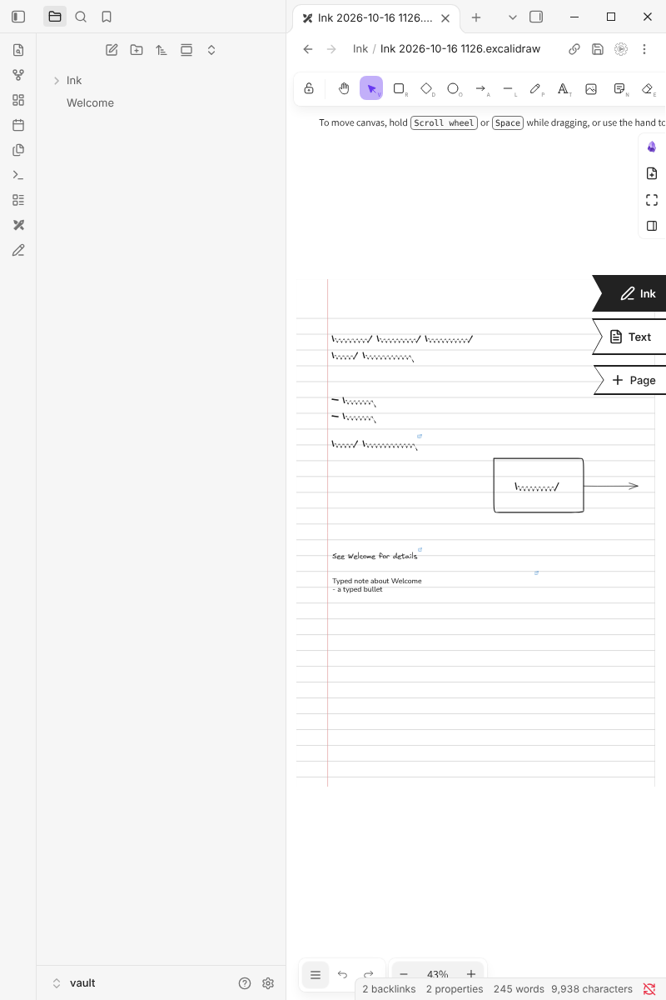
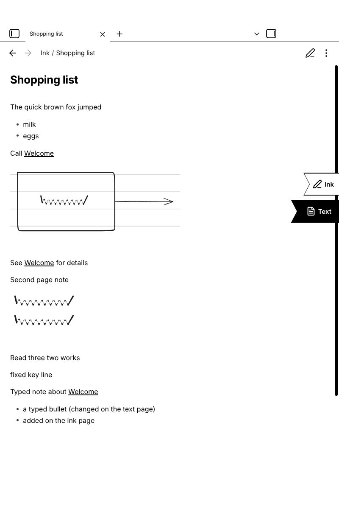
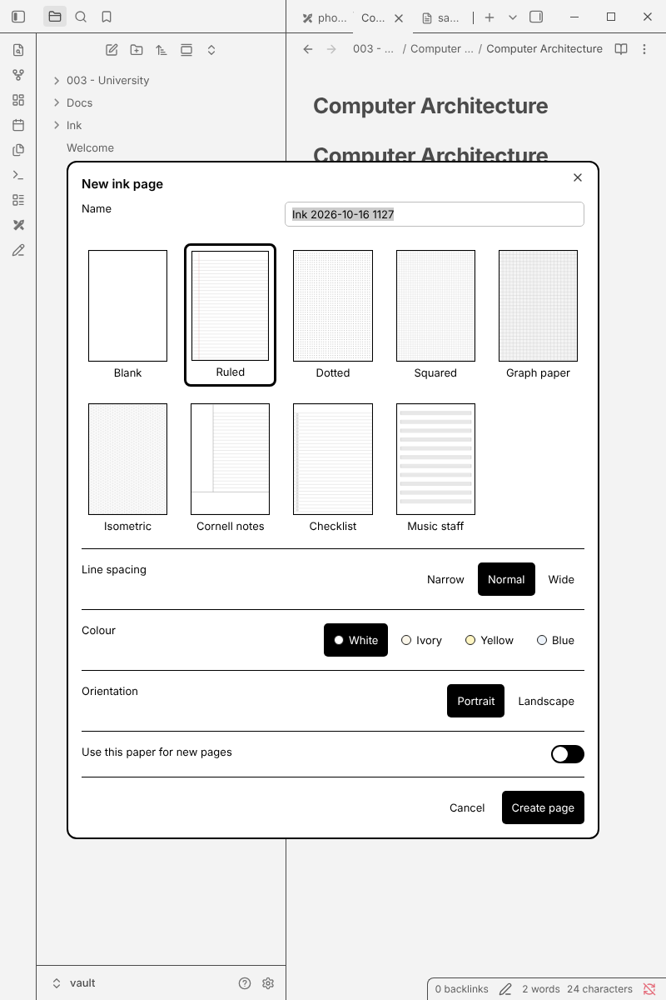
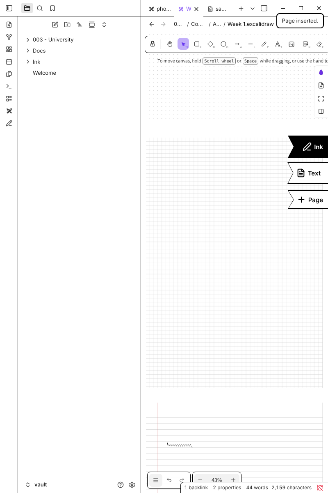
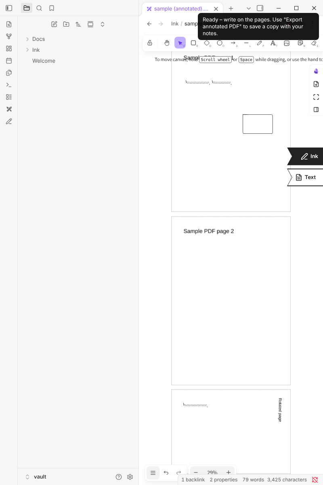
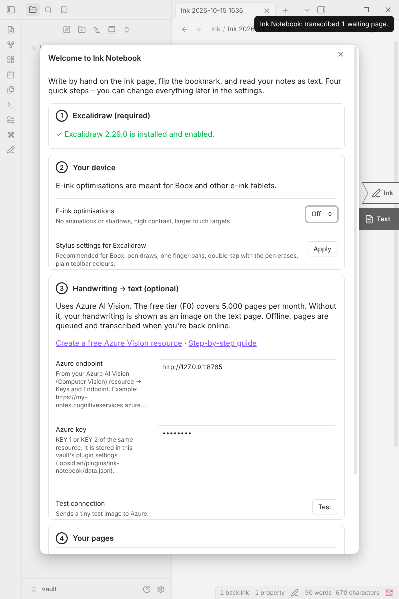

# Ink Notebook for Obsidian

**Handwritten notebook pages for Obsidian, built on top of [Excalidraw](https://github.com/zsviczian/obsidian-excalidraw-plugin), made for e‑ink tablets such as the Onyx Boox.**

Write by hand on the **ink page**, tap the **Text** bookmark, and read the same page as clean Markdown: handwriting transcribed, flowcharts and sketches embedded live from your drawing, links working like everywhere else in Obsidian. Type on the **text page** and your typed notes show up on the ink page too.

```
 ┌──────────────────────────────┐   ┌──────────────────────────────┐
 │  Ink page (Excalidraw)   ▶Ink│   │  Text page (Markdown)     Ink│
 │                         ◀Text│   │                         ▶Text│
 │  Meeting with [[Anna]]       │   │  Meeting with [[Anna]]       │
 │  - budget                    │ ⇄ │  - budget                    │
 │   ┌─────┐                    │   │  ![[…#^area=…]]  ← live      │
 │   │Start│──▶ …               │   │                   diagram    │
 │                              │   │  Typed notes … (also shown   │
 │   [typed notes card]         │   │  on the ink page)            │
 └──────────────────────────────┘   └──────────────────────────────┘
```

## Screenshots

Taken by the automated end-to-end tests in real Obsidian + Excalidraw (the "handwriting" is generated test strokes).

| Ink page | Text page (e-ink mode, mobile layout) |
| --- | --- |
|  |  |
| **Paper picker** (e-ink mode) | **Pages: dotted, an inserted squared page, ruled** |
|  |  |
| **PDF annotation** | **Setup assistant** |
|  |  |

## Features

- **Bookmark switcher** – two ribbon bookmarks on the right edge of every ink page: *Ink* (the drawing) and *Text* (the Markdown page). Tap to flip the page in the same tab. A third ribbon, *+ Page*, adds a page. Long‑press (or right‑click) for more: transcribe now, re‑transcribe, open side by side, add a page, change the paper. The bookmarks measure Excalidraw's toolbars and panels, the view header and the status bar and always sit clear of them, on any screen (on very short screens they shrink to icons).
- **Handwriting → text with Azure AI Vision** – supports both *Image Analysis 4.0* and *Read 3.2* (picked automatically). Lines become paragraphs, `-`/`•` lines become lists, `[ ]` becomes a task, bigger writing becomes a heading, handwritten `[[links]]` become real Obsidian links – on the text page, and as a tappable link icon right on your handwriting on the ink page. Uncertain words can be highlighted for proofreading.
- **Drawings embedded live** – flowcharts, boxes, arrows and sketches are detected automatically and embedded on the text page with Excalidraw's area embeds (`![[page.excalidraw#^area=…]]`). Change the drawing and the text page shows the change. Put something in a frame named *Diagram …* (or use *Turn the selection into a diagram*) to force it.
- **Your edits are kept** – fix a recognition mistake directly on the text page; the correction stays until you change that handwriting. Deleted or added paragraphs are remembered too.
- **Typed notes on the drawing** – anything you type on the text page (outside the transcript) appears on the ink page as a text card, and edits to that card flow back.
- **Works offline** – drawing, flipping, reading and typing all work without a connection. Handwriting that could not be transcribed is shown as a picture with a short note, queued, and transcribed automatically once you're back online.
- **PDF and image annotation like in the Boox Notes app** – put PDF pages (or an image) on an ink page as locked backgrounds, write on them, and *Export annotated PDF*: you get a new PDF with the original pages (text stays selectable) and your ink on top. Rotated pages are handled.
- **Paper like in GoodNotes** – pick the paper for every new page from a template gallery: blank, ruled, dotted, squared, graph paper, isometric, Cornell notes, checklist or music staff, each with narrow/normal/wide spacing, white/ivory/yellow/blue paper and portrait or landscape. Add pages after or before the page you're on or at the end (pages and writing below move down to make room), and change the paper of a page later – your writing stays.
- **Tidy folders** – a new page goes into the folder of the note you're in: the text page (`Week 1.md`) sits next to your other notes, the drawing and its paper go into a subfolder (`Attachments/` by default), so the folder only shows your notes.
- **E‑ink mode** – detected automatically on Boox: no animations or shadows, high contrast, larger touch targets, and one‑tap recommended stylus settings for Excalidraw (pen draws, finger pans, double‑tap erases).
- Everything stays plain Obsidian: two normal files per page, frontmatter links between them, backlinks and graph work as usual.

```
003 - University/
└── Computer Architecture/
    ├── Attachments/
    │   ├── Week 1.excalidraw.md      ← the ink page (drawing)
    │   └── ink-paper-dots.svg        ← its paper
    ├── Computer Architecture.md
    └── Week 1.md                     ← the text page
```

## Installation

You need **Obsidian 1.8.7+** and the **Excalidraw** plugin (Community plugins → *Excalidraw* → Install → Enable). PDF export needs Excalidraw 2.20 or newer.

### Option A – BRAT (easiest, also on the Boox)
1. In Obsidian: *Settings → Community plugins → Browse*, install and enable **BRAT**.
2. *Settings → BRAT → Add beta plugin* and enter `stefanmayer06/Obsidian-wrighting-for-eink`.
3. Enable **Ink Notebook** under *Community plugins*.

### Option B – manual
1. Download `main.js`, `manifest.json` and `styles.css` from the [latest release](https://github.com/stefanmayer06/Obsidian-wrighting-for-eink/releases).
2. Copy them to `<your vault>/.obsidian/plugins/ink-notebook/`.
3. Restart Obsidian and enable **Ink Notebook**.

When Ink Notebook starts the first time, a **setup assistant** opens (you can reopen it from the settings or the command *Open setup assistant*). It checks Excalidraw, turns on the e‑ink optimisations, offers the recommended pen settings, connects handwriting recognition and creates your first page.

## Setting up handwriting recognition (Azure, free tier)

Handwriting recognition is optional. Without it, the text page shows your handwriting as a picture (still with typed notes, links and diagrams).

1. Sign in at the [Azure portal](https://portal.azure.com) (a free account is enough).
2. Open [**Create Computer Vision**](https://portal.azure.com/#create/Microsoft.CognitiveServicesComputerVision).
   - *Region*: one close to you, e.g. **West Europe** or **East US**. (Image Analysis 4.0 is only offered in some regions; Ink Notebook falls back to Read 3.2 automatically.)
   - *Pricing tier*: **Free F0** – 5,000 images per month, 20 per minute.
3. After deployment open the resource → **Keys and Endpoint**. Copy the **Endpoint** and **KEY 1**.
4. In Obsidian: *Settings → Ink Notebook → Handwriting recognition*, paste both and press **Test**.

How many requests are used? One per *writing area* that changed since the last time (a page is split into areas so that writing in one corner does not re‑send the whole page). Results are cached, so flipping back and forth costs nothing.

Privacy: only your handwriting strokes are rendered and sent (black on white – never the PDF or paper background, never your typed text), to the Azure region you picked. The key is stored in `.obsidian/plugins/ink-notebook/data.json` inside your vault – keep that in mind if you share your vault.

## Using it on a Boox (Note Air, Tab Ultra, Go, …)

1. Install **Obsidian** from the Play Store (enable Google Play in the Boox settings if needed), open your vault, install Excalidraw and Ink Notebook as above.
2. In the setup assistant press **Apply** next to *Stylus settings for Excalidraw*: the pen draws, one finger pans/zooms, double‑tapping with the pen switches to the eraser.
3. Recommended Boox app optimisation for Obsidian (long‑press the Obsidian icon → *Optimize* / *E‑Ink Center*):
   - refresh mode **Fast** or **Balanced** for writing (**HD** if you mostly read),
   - use a light Obsidian theme (Ink Notebook's e‑ink mode makes it pure black on white).
4. Write on lined paper with normal letter size; recognition works best with words that don't touch the lines above and below.

## Daily use

| What | How |
| --- | --- |
| New page | Ribbon pencil icon, command **New ink page**, or right‑click a folder → *New ink page*. Choose the paper (and name, if enabled) in the picker; double‑tap a template to take it right away |
| Flip ink ⇄ text | Tap the other bookmark, or command **Flip between ink and text page** |
| Transcribe again | Long‑press the bookmark → *Transcribe handwriting now* (normally this happens automatically when you flip or leave the drawing) |
| Start over | *Re‑transcribe from scratch* discards edits made inside the transcript |
| Side by side | Long‑press the bookmark → *Open ink and text side by side* (typed notes update live) |
| Link pages | Write `[[Page name]]` by hand (after the next flip it gets a link icon you can tap), or type links in Excalidraw text or on the text page |
| Diagrams | Draw anything – it is detected. To force: frame named *Diagram …*, or select strokes → command **Turn the selection into a diagram** |
| More pages | Tap the **+ Page** bookmark (or command **Add a page…**): choose the paper and *after this page*, *before this page* or *at the end*. Command **Add a page after this one (same paper)** skips the picker |
| Change paper | Long‑press the bookmark → *Change the paper of this page…* (or the command of the same name) for the page in the middle of the screen |
| Annotate a PDF | Right‑click a PDF → *Annotate with Ink Notebook*, or command **Annotate a PDF…** |
| Save annotated PDF | On the ink page: command **Export annotated PDF** (creates `<name> (annotated).pdf`) |
| Annotate an image | Right‑click an image → *Annotate with Ink Notebook*; export with **Export annotated image** |
| Existing drawing | On any Excalidraw drawing tap the **+ Text** bookmark to give it a text page |
| Offline | Just keep working. Pages waiting for recognition show a small ◦ on the Text bookmark; command **Transcribe pages waiting for a connection** retries immediately |

### The text page

```markdown
---
ink-drawing: "[[Notes/Attachments/My page.excalidraw]]"
---
%% ink-notebook:start %%
…your transcribed handwriting, lists, diagrams…
%% ink-notebook:end … %%

Anything you type below (or above) the transcript is a typed note.
```

The two `%% … %%` lines mark the transcript; in Live Preview they are shown as a small "✍ From your handwriting" label and they are invisible in Reading view. Please don't delete them – if you do, Ink Notebook rebuilds the transcript and keeps your text.

## Settings

- **Pages** – where new pages go (folder of the current note, or a fixed folder), the subfolder for ink files (`Attachments` by default; empty = next to the text page), paper for new pages and whether to choose it every time, ask for a name, open the text page in reading or editing view, keep names in sync on rename/move.
- **Handwriting recognition** – endpoint, key, API version, language hint, highlight uncertain words, transcribe while writing, how long to wait when flipping, requests per minute, clickable handwritten links, diagram detection sensitivity, offline queue and cache.
- **Typed notes** – show them on the ink page, font and width of the card.
- **Display & e‑ink** – e‑ink mode (automatic / on / off), large touch targets, Excalidraw stylus settings, preferred bookmark position (they still move out of the way of toolbars), bookmark on all drawings.
- **PDF annotation** – page width on the ink page, how many pages to import without asking.

## Troubleshooting

- **"Ink Notebook is built on the Excalidraw plugin"** – install/enable Excalidraw and reopen the setup assistant.
- **Test connection fails** – 401 means a wrong key; 404 a wrong endpoint (copy it exactly from *Keys and Endpoint*); 429 means the free tier's 20 requests/minute were reached (it retries automatically).
- **Something was embedded as a picture instead of text** – that area was recognised as a drawing. Change *Diagram detection* to *Only clear drawings*, or write a little larger. Unrecognised handwriting is always shown as a picture rather than lost.
- **Text on the text page is wrong** – just correct it there; your correction stays.
- **Typed notes changed on both pages** – the text page wins; you get a notice.
- Developer console: `app.plugins.plugins["ink-notebook"].internals` exposes the recognition pipeline for debugging.

## How it works

- Each ink page is two files: `Attachments/Name.excalidraw.md` (the drawing) and `Name.md` (the text page), linked through the `ink-text` / `ink-drawing` frontmatter properties. The links use full paths, so pages called "Week 1" in different folders never get mixed up. Renaming or moving one renames/moves the other – moving `Week 1.md` to another folder moves the drawing into that folder's `Attachments/`. Pages made with older versions (both files side by side) keep working.
- Paper pages are locked SVG images (a few KB, stored once per folder) that remember their template, so *+ Page* suggests the paper of the page you're on.
- On a flip, your freedraw strokes are grouped into writing areas, rendered black on white and sent to Azure; the returned word boxes are mapped back onto the strokes to separate handwriting from drawings. Drawings are clustered into diagrams.
- Each diagram gets an invisible, locked rectangle in the drawing; the text page embeds that area with `#^area=<id>`, so the picture is always live.
- The transcript region stores a compact fingerprint of what was generated, which is how your corrections, deletions and additions are recognised and kept.
- Ink Notebook never edits the drawing file directly: all changes go through Excalidraw's scripting API (ExcalidrawAutomate) while the drawing is open.

## Development

```bash
npm install
npm test          # unit tests (vitest)
npm run build     # type-check + bundle main.js
```

The pure logic (OCR parsing, classification, layout, transcript merging, PDF maths) lives in `src/core` and is covered by unit tests; Obsidian/Excalidraw integration is in `src/obsidian`.

**Releasing:** bump `version` in `manifest.json`/`package.json` (and add it to `versions.json`), then on GitHub open *Actions → Build & release → Run workflow* (or push a tag like `1.0.1`). The workflow runs the tests, builds and publishes a release with `main.js`, `manifest.json` and `styles.css` – which is what BRAT and manual installs download.

`e2e/` contains end-to-end tests that run the plugin inside the real Obsidian desktop app with the real Excalidraw plugin and a fake Azure server (see `e2e/README.md`).

## License

MIT
