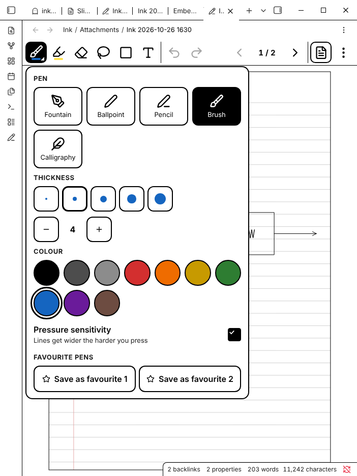
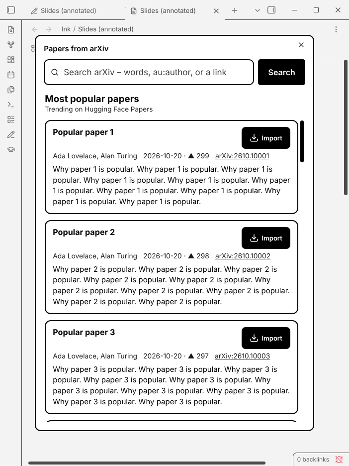
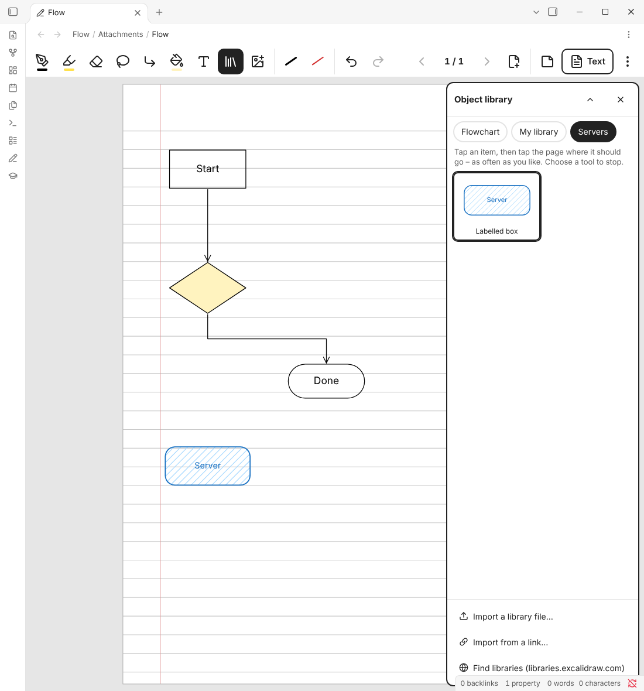
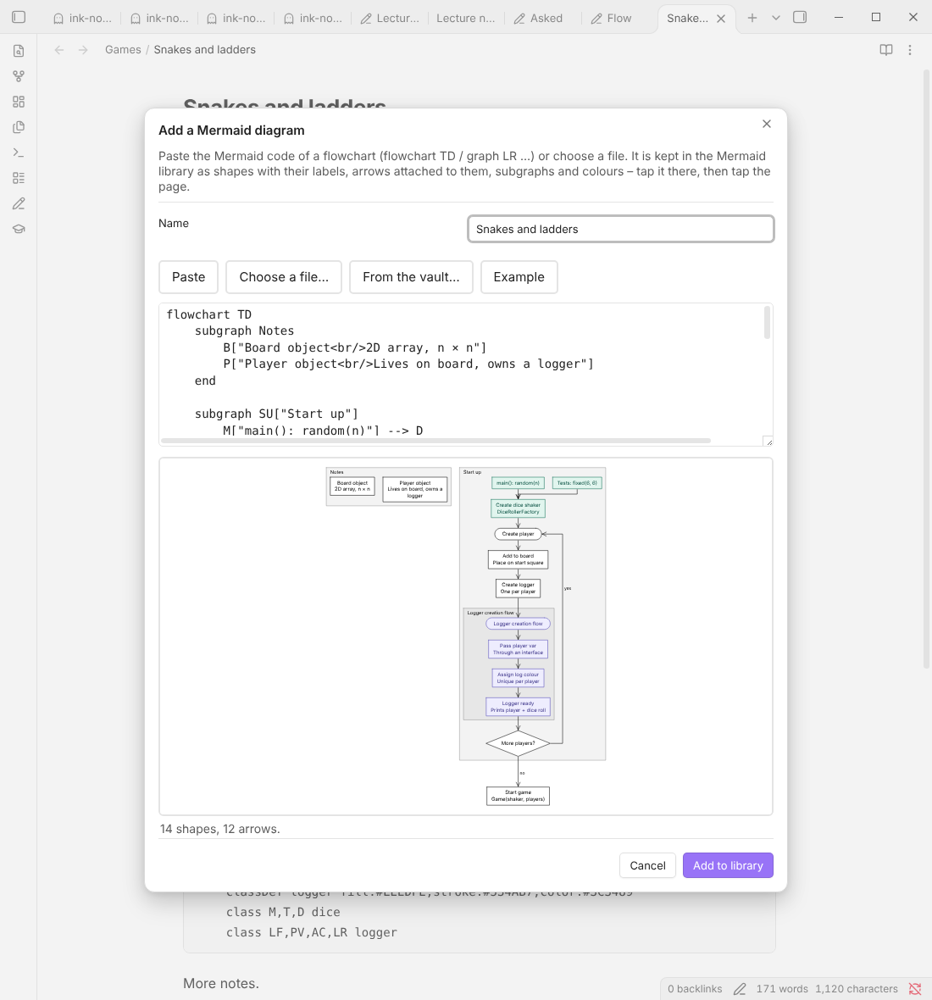
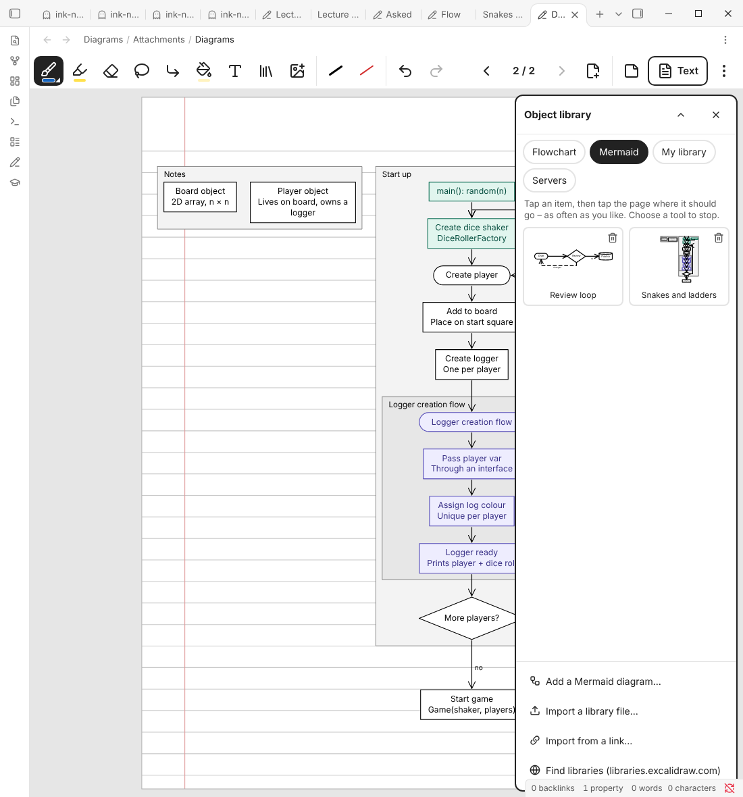

# Ink Notebook for Obsidian

**Handwritten notebooks in Obsidian that feel like the Boox Notes app – made for e‑ink tablets such as the Onyx Boox Note Air.** Write with the pen on paper pages, flip to the **Text** page and read the same notes as Markdown: handwriting transcribed, drawings shown live, links working like everywhere else in Obsidian.

Ink Notebook has its own pen engine. It draws every stroke the moment the pen moves – nothing is redrawn while you write – so it stays fast on e‑ink screens and on pages full of writing. There is nothing else to install.

```
 ┌───────────────────────────────────────────┐     ┌──────────────────────────────┐
 │ ✒ ▁ ⌫ ◌ □ T ⊕ │ ↶ ↷ │  ‹ 3 / 12 ›  + │ Text ⋮│     │  Text page (Markdown)    Ink │
 ├───────────────────────────────────────────┤     │                         Text │
 │   Meeting with [[Anna]] ↗                  │  ⇄  │  Meeting with [[Anna]]       │
 │   – budget                                 │     │  - budget                    │
 │    ┌─────┐                                 │     │  [live drawing of the box]   │
 │    │Start│──▶ …                            │     │                              │
 └───────────────────────────────────────────┘     └──────────────────────────────┘
```

## Screenshots

Taken by the automated end-to-end tests in real Obsidian (the "handwriting" is generated test strokes).

| Ink page | Text page (e-ink mode) |
| --- | --- |
|  |  |
| **Pen options** | **All pages** |
|  |  |
| **Papers from arXiv** | **Flowcharts, fills, object libraries** |
|  |  |
| **Adding a Mermaid diagram** | **A Mermaid diagram on the page** |
|  |  |

## Writing – like in the Boox Notes app

The toolbar sits at the top (or bottom, left, right – see *More → View*). Tap a tool to use it; tap it again for its options. The cards are large and flat, made for a pen and for e‑ink.

| Tool | What it does |
| --- | --- |
| **Pen** | Fountain pen, ballpoint, pencil, brush and calligraphy pen. Five thicknesses (plus fine steps), ten colours (they show as greys on black-and-white screens), pressure sensitivity on/off. Two **favourite pens** sit next to the tools for quick switching |
| **Highlighter** | Transparent, stays underneath your writing, six colours |
| **Eraser** | **Partial** (erases only where you rub), **whole stroke**, or **lasso** (erases everything inside a loop); four sizes; *Clear this page*. The **eraser end of the pen** always erases, and holding the **side button** erases too (configurable) |
| **Lasso** | Draw a loop around writing (or tap one item) to select it. Drag to move, the corner to resize, the top handle to rotate. The bar above the selection: delete, cut, copy, duplicate, colour, **Fill**, *Figure* (always show it as a picture on the text page), **To text** (turns the handwriting into a typed text box) and **To library** (keeps it in your object library) |
| **Shapes** | Line, arrow, elbow arrow, dashed line, rectangle, ellipse, circle, triangle, diamond – drag to draw. New shapes can be filled. An arrow drawn from one shape to another **stays attached** to both |
| **Fill** | Tap inside a shape – or inside any area closed by lines, like a box drawn with four strokes or a circle drawn with the pen – to fill it. Twelve colours, solid, hatched or cross-hatched; *Remove fills* takes a fill away. Fills stay underneath your writing |
| **Text** | Tap the page and type; tap a text to change it. Tap inside a shape to give it a **label**, centred in the shape, that moves with it. Four sizes |
| **Object library** | Flowchart shapes, **Mermaid diagrams** and the objects of **Excalidraw libraries**: tap one, then tap the page to put it there (see *Flowcharts and object libraries*) |
| **Insert** | Images (from the vault or the device), a link to a note (a tappable chip on the page), objects from the library, a Mermaid diagram, pages from a PDF |
| **Undo / Redo** | Unlimited while the page is open |

Smart pen features (each can be turned off):

- **Hold to snap** – draw a line, rectangle, triangle or circle and keep the pen still at the end: it becomes a clean shape.
- **Scribble to erase** – scratch quickly back and forth over writing to erase it.

Fingers never draw (unless you turn on *Draw with a finger*), so your palm can rest on the screen:

- **swipe** left/right (or up/down) to turn pages, **pinch** to zoom, drag to move a zoomed page, **double-tap** to zoom in or back to the whole page,
- **two-finger tap** = undo, **three-finger tap** = redo,
- touches while the pen is near the screen are ignored (palm rejection).

With a keyboard: `Ctrl/Cmd+Z` / `Ctrl/Cmd+Shift+Z`, `Delete`, `Ctrl/Cmd+C/X/V/D/A`, `PageUp`/`PageDown` or arrow keys to turn pages, `P` pen, `H` highlighter, `E` eraser, `L` lasso, `S` shapes, `F` fill, `T` text, `Ctrl/Cmd` + `=` / `-` / `0` to zoom. All tools and page actions are also commands, so you can give them hotkeys.

### Pages and paper

A notebook has pages, like in Boox Notes. `‹ 3 / 12 ›` in the toolbar turns pages; tap the number for **all pages** (move, duplicate, delete, add). `+` adds a page after the current one; *More → Add a page…* lets you choose the paper and put it before, after or at the end.

Paper templates like in GoodNotes and Boox Notes: blank, ruled, dotted, squared, graph paper, isometric, Cornell notes, checklist and music staff, each with narrow/normal/wide spacing, white/ivory/yellow/blue paper and portrait or landscape (A4). Change the paper of a page any time – your writing stays.

### Flowcharts and object libraries

The **library** button in the toolbar (or *Insert → From the object library…*, or the command *Open the object library*) opens the object library next to the page:

- **Flowchart** – the usual flowchart symbols: process, decision, start/end, input/output, document, predefined process, database, manual input, preparation, manual operation, delay, display, connector, off-page connector, merge, extract and comment. They are drawn in the pen colour and thickness you have chosen, and with the fill chosen for shapes.
- **Excalidraw libraries** – every `.excalidrawlib` file in your vault, and the library of the [Excalidraw plugin](https://github.com/zsviczian/obsidian-excalidraw-plugin) if you use it. Get more at [libraries.excalidraw.com](https://libraries.excalidraw.com): *Import from a link…* takes the link of a library's *Download* button (or its *Add to Excalidraw* link), *Import a library file…* a file you downloaded. Rectangles, ellipses, diamonds, lines, curves, arrows, pen drawings and text come over with their colours, fills, hatching, rounded corners and rotation; labels stay in their shapes and arrows stay attached. (Pictures in libraries are left out.)
- **Mermaid** – your Mermaid diagrams, turned into ink (see *Mermaid diagrams* below).
- **My library** – lasso something on the page and tap **To library** to keep it. My library is an Excalidraw library too, so Excalidraw can use what you keep in it (and the trash button removes an item).

Tap an object, then tap the page where it should go – as often as you like; choosing a tool stops. On a narrow screen the library folds away to its title while you place objects (tap it to open it again).

To draw a flowchart: place the shapes, then connect them with **Arrow** or **Elbow arrow** (in the library, or in the shape tool) – draw from one shape to the next. The arrow starts and ends at the shapes' outlines and stays attached: move a shape with the lasso and its arrows follow (an elbow arrow keeps its right angles). Tap inside a shape with the **Text** tool to type its label, or write into it by hand. **Fill** colours the shapes.

### Mermaid diagrams

Flowcharts written in [Mermaid](https://mermaid.js.org/syntax/flowchart.html) – the ```` ```mermaid ```` blocks of your notes, or code from mermaid.live, GitHub or an AI chat – go into the library as real ink:

- **Add one** with *Add a Mermaid diagram…* at the bottom of the library (or *Insert → Mermaid diagram…*, or the command *Add a Mermaid diagram to the object library*). **Paste** the code (or type it), **Choose a file…** on the device (`.mmd`, `.mermaid`, a Markdown note, a text file) or pick a note **From the vault…** – a note with several diagrams lets you choose one. You see the diagram as ink while you type, and what is wrong (with the line) when it cannot be read. **Add to library**, and on an ink page it is ready to be placed: tap the page.
- **From a note**: right-click inside a ```` ```mermaid ```` block → *Add this Mermaid diagram to the ink library* (or run the command with the cursor in it). It is named after the note. A `.mmd` or `.mermaid` file: right-click it → *Add to the ink object library*.
- **On the page** every node is a shape with its label in it, every link an **elbow arrow attached to the shapes** at its ends – move a shape with the lasso and its arrows follow, tap into it with the Text tool to change the label, fill it, erase it, like any shape you drew. Subgraphs (also inside subgraphs) are boxes with their title, link labels sit beside their links, links that go back up go round the side. A whole diagram may fill most of the page (it is made smaller when it is bigger than that).
- **What is understood**: `flowchart`/`graph` with `TD`/`TB`/`BT`/`LR`/`RL` (and `direction` in subgraphs); the shapes `[rect]`, `(rounded)`, `([stadium])`, `[[subroutine]]`, `[(database)]`, `((circle))`, `(((double circle)))`, `>flag]`, `{decision}`, `{{hexagon}}`, `[/lean/]`, `[\lean\]`, `[/trapezoid\]`, `[\trapezoid/]` and `A@{ shape: … }`; links `-->`, `---`, `-.->`, `==>`, `<-->`, `--o`, `--x`, `~~~`, longer links (`--->`), labels (`-- yes -->`, `-->|yes|`), chains and `&`; labels with `"quotes"`, `<br/>`, Markdown strings and entities; `classDef`, `class`, `:::`, `style` and `linkStyle` colours (fill, stroke, text colour, line width, dashes); comments and frontmatter (`title:`). Other kinds of Mermaid diagrams (sequence, class, state, …) are not turned into ink yet.
- **Where they are kept**: each diagram is a note with a ```` ```mermaid ```` block in the *Mermaid* folder of the library folder (`Ink libraries/Mermaid/`). Obsidian shows it as a Mermaid diagram too; change the note and the library item changes. The trash button on an item moves its note to the trash.

## The text page

- **Handwriting → text with Azure AI Vision** – with your own free Azure key, or with the optional *Ink Notebook Cloud* subscription. Lines become paragraphs, `-`/`•` lines become lists, a box drawn in front of a line (or a written `[ ]`) becomes a task – `- [x]` if you ticked or crossed it –, bigger writing becomes a heading, handwritten `[[links]]` become real Obsidian links on the text page and a tappable link button on the ink page.
- **Hand-drawn tables become Markdown tables** – draw a line under the headings and lines between the columns, write in the cells.
- **Drawings shown live** – flowcharts, boxes, arrows and sketches are detected and shown on the text page with an `ink-figure` block that draws that part of the ink page – change the drawing and the text page follows. Tap the figure to jump to the ink page. To force a picture, select it with the lasso and tap *Figure*.
- **Your edits are kept** – fix a recognition mistake directly on the text page; the correction stays until you change that handwriting.
- **Typed notes** – anything you type on the text page outside the transcript is shown on the ink page in the *Typed notes* panel (toolbar), where you can edit it too.
- **Works offline** – handwriting that could not be transcribed is shown as a picture, queued and transcribed automatically once you're back online.

## PDFs and pictures

- **Annotate a PDF** – right-click a PDF → *Annotate with Ink Notebook* (or the command). Its pages become the pages of an ink page (linked, not copied); write on them like on paper. Rotated pages are handled.
- **Export** (*More → Export*): the **annotated PDF** (the original PDF with your ink drawn on top as vectors – its text stays selectable), the **whole notebook as PDF** (paper, PDF pages, pictures, ink, all as vectors), or **this page as an image**.
- **Annotate a picture** the same way (right-click an image).

## Papers from arXiv

Find a paper and write on it, without leaving Obsidian:

1. Tap the **graduation cap** in the ribbon (or the command **Import a paper from arXiv**).
2. With nothing searched you see the **most popular papers** (trending on Hugging Face Papers); tap **Load more** for more. Or **search arXiv**: type words, `"a phrase"`, `au:name` for an author, `ti:` for the title, `cat:cs.LG` for a category – or paste an arXiv link or id (`2405.03150`).
3. Each card shows the title, authors, date and abstract (tap the abstract to read all of it). Tap **Import**.

The PDF is downloaded and becomes the pages of a new ink page – write, highlight and erase on it like on any page, and *More → Export → Annotated PDF* gives you the paper with your notes. Its text page (in the *Papers* folder, see Settings) has the title, authors, arXiv id and link as properties, and the abstract above the transcript of your handwritten notes. A paper you imported before shows **Open** instead.

From an ink page, *Insert → Pages of a paper from arXiv…* adds a paper's pages to that ink page instead.

## Files

Each ink page is two normal files:

```
003 - University/
└── Computer Architecture/
    ├── Attachments/
    │   └── Week 1.ink.md         ← the ink page (pages and strokes)
    ├── Computer Architecture.md
    └── Week 1.md                 ← the text page
```

- `Week 1.ink.md` is a Markdown file, so it syncs with Obsidian Sync and every other sync, has properties, and its links (notes linked on the pages, pictures, PDFs) show up as backlinks. Ink Notebook opens it in the ink view; *More → Open as Markdown* shows the file itself. Embedding it in a note (`![[Week 1.ink]]`) shows its pages.
- The text page links to it (`ink-drawing`) and back (`ink-text`). Renaming or moving one renames/moves the other.
- Both files have the same name: `Week 1.md` and `Week 1.ink.md`. A note that is an ink page itself (`Week 1.md` with the `ink-notebook` property) moves into the ink subfolder as `Week 1.ink.md` when its text page is made, so the text page gets its name; **Match up the names of ink and text pages** does the same for pages made before.
- New pages go into the folder of the note you're in, a fixed folder, or the one you choose each time; the ink file goes into a subfolder (`Attachments` by default), so your folders only show your notes.
- Any note can get an ink page later (**Add an ink page to this note**): `Note.md` stays as it is, `Attachments/Note.ink.md` is added.
- Object libraries live in `Ink libraries/` (see Settings): imported Excalidraw libraries, `My library.excalidrawlib`, and `Mermaid/` with one note per Mermaid diagram.

## Installation

You need **Obsidian 1.8.7+** – nothing else.

### Option A – BRAT (easiest, also on the Boox)
1. In Obsidian: *Settings → Community plugins → Browse*, install and enable **BRAT**.
2. *Settings → BRAT → Add beta plugin* and enter `stefanmayer06/Obsidian-wrighting-for-eink`.
3. Enable **Ink Notebook** under *Community plugins*.

### Option B – manual
1. Download `main.js`, `manifest.json` and `styles.css` from the [latest release](https://github.com/stefanmayer06/Obsidian-wrighting-for-eink/releases).
2. Copy them to `<your vault>/.obsidian/plugins/ink-notebook/`.
3. Restart Obsidian and enable **Ink Notebook**.

When Ink Notebook starts the first time, a **setup assistant** opens (reopen it from the settings or the command *Open setup assistant*): e‑ink optimisations, pen behaviour, handwriting recognition and your first page.

### Coming from an earlier version?

Earlier versions of Ink Notebook (up to 1.3) were built on Excalidraw. Run the command **Convert ink pages made with Excalidraw (earlier versions)**: every old ink page gets an ink notebook (`Name.ink.md`) next to it with the same pages, writing, shapes, text and pictures, and its text page is pointed at it (the next transcription updates the pictures on the text page). The old `.excalidraw.md` files are left as they are – delete them when you're happy.

## Using it on a Boox (Note Air, Tab Ultra, Go, …)

1. Install **Obsidian** from the Play Store (enable Google Play in the Boox settings if needed), open your vault and install Ink Notebook as above.
2. In Boox's **E-Ink Center** (long-press the Obsidian icon → *Optimize*): refresh mode **Fast** or **Balanced** for writing (**HD** if you mostly read). Ink Notebook's e‑ink mode (on automatically on Boox) makes Obsidian pure black on white, without animations.
3. Keep *Draw with a finger* off: then only the pen writes and your hand can rest on the screen.
4. Write on ruled paper with normal letter size; recognition works best with words that don't touch the lines above and below.
5. On colour screens (Note Air C, Tab Ultra C, Go Color) the ink colours and highlighters show in colour.

## Setting up handwriting recognition

Handwriting recognition is optional. Without it, the text page shows your handwriting as a picture (still with typed notes, links and drawings). Choose under *Settings → Ink Notebook → Handwriting recognition → Service* (or in the setup assistant):

### Ink Notebook Cloud (subscription)

No Azure account needed: subscribe, paste the license key from your purchase e-mail, press **Check** – done. The subscription includes a monthly allowance of recognitions (each changed writing area of a page counts as one); *Check* shows how much is used. Subscriptions are sold through [Polar](https://polar.sh), which also handles invoices and taxes; you manage or cancel yours in Polar's customer portal (linked in the settings). The option appears in the plugin while the service is open for subscriptions.

### Your own Azure key (free tier)

1. Sign in at the [Azure portal](https://portal.azure.com) (a free account is enough).
2. Open [**Create Computer Vision**](https://portal.azure.com/#create/Microsoft.CognitiveServicesComputerVision).
   - *Region*: one close to you, e.g. **West Europe** or **East US**. (Image Analysis 4.0 is only offered in some regions; Ink Notebook falls back to Read 3.2 automatically.)
   - *Pricing tier*: **Free F0** – 5,000 images per month, 20 per minute.
3. After deployment open the resource → **Keys and Endpoint**. Copy the **Endpoint** and **KEY 1**.
4. In Obsidian: *Settings → Ink Notebook → Handwriting recognition*, paste both and press **Test**.

How many requests are used? One per *writing area* that changed since the last time (a page is split into areas so that writing in one corner does not re-send the whole page). Results are cached, so flipping back and forth costs nothing.

Privacy: only your handwriting strokes are rendered and sent (black on white – never the PDF or paper background, never your typed text) – with your own key to the Azure region you picked, with Ink Notebook Cloud to the Ink Notebook server (EU), which passes them to Azure AI Vision and keeps nothing; Azure deletes them within 24 hours. The key (Azure key or license key) is stored in `.obsidian/plugins/ink-notebook/data.json` inside your vault – keep that in mind if you share your vault.

## Daily use

| What | How |
| --- | --- |
| New page | Ribbon pencil icon, command **New ink page**, or right-click a folder → *New ink page*. Type its name (the date and time is filled in – keep it or type over it) and choose the paper; the dialog shows the folder – *Change…* puts the page elsewhere (or type the name of a new folder) |
| Draw on a note you already have | Command **Add an ink page to this note**, or right-click the note (in the file list or the editor) → *Add an ink page*. The note keeps its text and becomes the text page; the transcript goes below its text |
| Daily notes | *Settings → Pages → Daily notes*: new daily notes come with an ink page (optionally opened to write on). Command **Open today's daily note on the ink page** works with any setting |
| Names that don't match | Command **Match up the names of ink and text pages** (e.g. `2026-10-27 (text).md` → `2026-10-27.md` with `Attachments/2026-10-27.ink.md`); it lists the renames first |
| Flip ink ⇄ text | **Text** in the toolbar, the **Ink** bookmark on the text page, or command **Flip between ink and text page** |
| Transcribe again | *More → Transcribe handwriting now* (normally this happens when you open the text page or leave the ink page) |
| Start over | *More → Re-transcribe from scratch* discards edits made inside the transcript |
| Side by side | *More → Open the text page side by side* |
| Link pages | Write `[[Page name]]` by hand (it gets a link button after the next transcription), or *Insert → Link to a note* |
| Tasks | Draw a small box in front of the line (`- [ ]`); tick or cross it when done (`- [x]`) |
| Tables | Draw a line under the headings and lines between the columns, write in the cells |
| Drawings | Draw anything – it is detected. To force: lasso → *Figure* |
| Flowcharts | Library button → *Flowchart* → tap a shape, tap the page; draw arrows from shape to shape; text tool → tap a shape for its label |
| Fill | Fill tool → tap inside a shape or an area enclosed by lines; or lasso → *Fill* |
| Excalidraw libraries | Library button → *Import from a link…* / *Import a library file…*; lasso → *To library* keeps your own |
| Pages | `+` adds a page after this one, `‹ ›` or a swipe turns pages, the page number opens all pages, *More → Add a page…* chooses paper and position, *More → Paper of this page…* changes the paper |
| Handwriting → typed text | Lasso the handwriting → **To text** |
| Annotate a PDF | Right-click a PDF → *Annotate with Ink Notebook*; *More → Export* for the annotated PDF |
| Read a paper | Ribbon graduation cap → search arXiv or pick a popular paper → **Import** |
| Offline | Just keep working. Pages waiting for recognition show a small ◦ on **Text**; command **Transcribe pages waiting for a connection** retries immediately |

### The text page

```markdown
---
ink-drawing: "[[Notes/Attachments/My page.ink]]"
---
%% ink-notebook:start %%
…your transcribed handwriting, lists, figures…
%% ink-notebook:end … %%

Anything you type below (or above) the transcript is a typed note.
```

The two `%% … %%` lines mark the transcript; in Live Preview they are shown as a small "✍ From your handwriting" label and they are invisible in Reading view. Please don't delete them – if you do, Ink Notebook rebuilds the transcript and keeps your text.

## Settings

- **Writing** – pen side button (erase, lasso, nothing), draw with a finger, pressure sensitivity, scribble to erase, snap shapes, swipe to turn pages, two/three-finger taps, whole page or page width, toolbar position, low-latency drawing (automatic: off on e-ink screens).
- **Pages** – where new pages go (folder of the current note, a fixed folder, or ask every time), the subfolder for ink files (`Attachments` by default; empty = next to the text page), paper for new pages and whether to choose it every time, ask for a name (on by default; off names pages with the date and time), open the text page in reading or editing view, daily notes with an ink page (off / with an ink page / with an ink page opened to write on), match up the names of ink and text pages, keep names in sync on rename/move.
- **Handwriting recognition** – service (Ink Notebook Cloud or your own Azure key), license key or endpoint and key, API version, language hint, highlight uncertain words, transcribe while writing, how long to wait when flipping, requests per minute, clickable handwritten links, diagram detection sensitivity, offline queue and cache.
- **Display & e‑ink** – e‑ink mode (automatic / on / off), large touch targets, position of the bookmarks on the text page.
- **PDF annotation** – how many pages to import without asking, the folder for papers from arXiv (`Papers` by default).
- **Object libraries** – the folder for imported libraries and *My library* (`Ink libraries` by default).

## Troubleshooting

- **The page flickers while writing** – set *Settings → Ink Notebook → Low-latency drawing* to *Off*.
- **Colours and the highlighter have a stripy pattern on a colour e-ink screen** (and look right while the side panel is open) – set *Low-latency drawing* to *Automatic* (it is then off on e-ink screens) or *Off*. If the device is not recognised as e-ink, set *E-ink optimisations* to *Always on* as well.
- **Writing feels slow on the Boox** – set Obsidian's refresh mode to *Fast* or *Balanced* in the Boox E-Ink Center; avoid *HD* / *Regal* while writing.
- **"This license key is not active"** (Ink Notebook Cloud) – check the key in the settings (press *Check*), or renew the subscription in Polar's customer portal. Pages are transcribed automatically once the key works again.
- **"You have used all … recognitions for this month"** – the allowance renews on the first of the month; until then pages are kept as pictures and queued.
- **Test connection fails** – 401 means a wrong key; 404 a wrong endpoint (copy it exactly from *Keys and Endpoint*); 429 means the free tier's 20 requests/minute were reached (it retries automatically).
- **Something was shown as a picture instead of text** – that area was recognised as a drawing. Change *Diagram detection* to *Only clear drawings*, or write a little larger. Unrecognised handwriting is always shown as a picture rather than lost.
- **A table is shown as a picture** – the lines of a table have to be long and fairly straight and cross each other (or nearly touch), and the writing in at least two cells has to be readable.
- **A box in front of a line did not become a task** – the box has to be closed, about as high as the writing (up to about twice), right in front of the first word and empty or ticked.
- **Text on the text page is wrong** – just correct it there; your correction stays.
- **"Tap inside a shape or a closed area to fill it"** – the lines around the spot do not meet: close the gap (small gaps are bridged) or tap a smaller area. A fill that went too far is undone with *Undo*.
- **An object from an Excalidraw library looks a little different** – Ink Notebook draws clean lines (not Excalidraw's sketchy ones) in its own font, and leaves out pictures, which libraries do not contain.
- **"This note has text in it"** – the note has the `ink-notebook` property (which makes a note open as an ink page) but text instead of handwriting. Nothing is changed until you choose: *Keep the text and add an ink page* removes the property and gives the note its own ink page.
- **A text page is called "Name (text)"** – its ink page had the name (earlier versions turned a note into an ink page when it was opened in a tab that showed an ink page). Run **Match up the names of ink and text pages**.
- **"This ink page could not be opened"** – the file was changed in a way Ink Notebook does not understand. It is not touched; *Open as Markdown* to look at it (e.g. a sync conflict).
- Developer console: `app.plugins.plugins["ink-notebook"].internals` exposes the recognition pipeline and the file reader for debugging.

## How it works

- **The pen engine** (`src/ink`) draws on one opaque canvas that always shows the page as it looks now. Each pen movement adds one curve piece, drawn straight onto it (with every coalesced/raw pointer event, and the low-latency `desynchronized` canvas except on e-ink screens, where Boox shows that canvas with the dither pattern of its fast refresh), so the cost per movement does not grow with the page. Erasing and moving redraw only the area that changed; neighbouring pages are rendered in the background so that turning pages is instant. A second canvas shows previews (highlighter, lasso, shapes, moved selections). Strokes keep their pressure and are drawn with the same code live, on redraw, in figures and in exports (as SVG paths – the PDF export uses them too), so they look the same everywhere.
- **The file** (`core/ink/codec.ts`): a Markdown file whose ink data sits in a hidden `%% ```ink-data … ``` %%` block, one line per page and per stroke; points are delta-encoded integers (0.1 units, pressure in 1/255) in base64. Fills, connectors and the like follow a stroke's points as `key:value` words, which earlier versions skip (they show the stroke without its fill). Edits are immutable updates (undo keeps old versions; they share everything that did not change).
- **Fills** (`core/ink/fill.ts`) are drawn in a pass of their own underneath the highlighter and the ink. The fill tool fills the smallest shape around the tap; when other lines divide it, or several strokes enclose the spot, the strokes are drawn into a grid, flood-filled from the tap and the outline is traced – that becomes an *area*, a stroke that is only a fill. Hatching is cut to the shape as plain lines, so it looks the same on the page, in figures and in the PDF.
- **Flowcharts** (`core/ink/connectors.ts`): an arrow remembers the shapes it was drawn between and is routed again, outline to outline, when they move. **Object libraries** (`core/ink/excalidrawLib.ts`) are read and written in Excalidraw's `.excalidrawlib` format.
- **Recognition**: strokes are grouped into writing areas, rendered black on white (without long straight lines such as table lines and underlines, which only confuse OCR) and sent to Azure; the returned word boxes are mapped back onto the strokes to separate handwriting from drawings. Drawings are clustered into diagrams, each with a diagram area stored in the ink page; the text page shows that area with an `ink-figure` block.
- The transcript region stores a compact fingerprint of what was generated, which is how your corrections, deletions and additions are recognised and kept.

## Development

```bash
npm install
npm test          # unit tests (vitest)
npm run build     # type-check + bundle main.js
npm run harness   # the pen engine in a plain browser page, driven with real pen input (Playwright)
```

The pure logic (the ink model, file format, pens, erasers, shapes, OCR parsing, classification, layout, transcript merging, PDF maths) lives in `src/core` and is covered by unit tests; the pen engine and its toolbar (DOM only) are in `src/ink`; the Obsidian integration is in `src/obsidian`.

**Releasing:** run `npm run set-version -- 1.3.1` (it updates `manifest.json`, `package.json`, `package-lock.json` and `versions.json`) and commit, then on GitHub create a release with the tag `1.3.1` – just the version, without a "v" – or open *Actions → Build & release → Run workflow*. The workflow runs the tests, builds and publishes the release with `main.js`, `manifest.json` and `styles.css` – which is what BRAT and manual installs download. It writes the tag's version into the released `manifest.json`, so a release always matches its tag; Obsidian's community plugin list reads the version from the repository, though, so keep `manifest.json` bumped there too.

`e2e/` contains end-to-end tests that run the plugin inside the real Obsidian desktop app, write on ink pages with real pen events and use a fake Azure server (see `e2e/README.md`).

`supabase/` is the Ink Notebook Cloud server (a Supabase Edge Function and its database migrations).

## Payments, accounts and network use

- **Payment:** Ink Notebook Cloud is an optional paid subscription. Everything else – including handwriting recognition with your own Azure key – is free.
- **Account:** Ink Notebook Cloud needs a license key from a purchase (sold through Polar). Nothing else needs an account.
- **Network use:** Ink Notebook works offline. It connects to the internet only for handwriting recognition and, when you use *Papers from arXiv*, to find and download papers: with your own key it sends handwriting images to *your* Azure AI Vision resource; with Ink Notebook Cloud it sends handwriting images and your license key to the Ink Notebook server (Supabase, Frankfurt), which checks the key with Polar and passes the images to Azure AI Vision. When you open the handwriting recognition settings or the setup assistant, the plugin asks the Ink Notebook server whether the subscription is offered (no personal data is sent). *Papers from arXiv* sends your search words to the arXiv API (export.arxiv.org), loads the list of popular papers from Hugging Face (huggingface.co) and downloads the PDF of a paper you import from arxiv.org – only when you open it or search. *Import from a link…* in the object library downloads the library from the link you paste (usually libraries.excalidraw.com); *Find libraries* opens libraries.excalidraw.com in your browser. There is no telemetry and no ads.

## License

Copyright (C) 2026 Stefan Mayer

Ink Notebook – the plugin and the Ink Notebook Cloud server in `supabase/` – is free software: you can redistribute it and/or modify it under the terms of the **GNU Affero General Public License** as published by the Free Software Foundation, either version 3 of the License, or (at your option) any later version (`AGPL-3.0-or-later`, see [`LICENSE`](LICENSE)). It is distributed in the hope that it will be useful, but WITHOUT ANY WARRANTY; without even the implied warranty of MERCHANTABILITY or FITNESS FOR A PARTICULAR PURPOSE. See the license for details.

Releases up to and including 1.1.0 were published under the MIT license and remain available under it. The license texts of Ink Notebook and of all third-party code in the released `main.js` (pdf-lib and the libraries it uses, lz-string) are appended to the end of that file.
